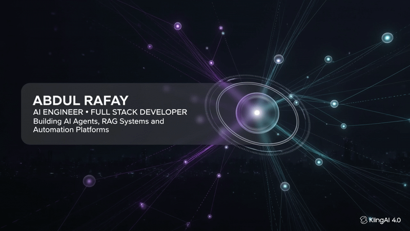

<div align="center">   <br> 

<br><br>

<a href="https://abdul-rafay-dev.vercel.app/">
  
</a>
<a href="https://linkedin.com/in/abdulrafay-sid">
  
</a>
<a href="https://github.com/abdul-rafay12">
  
</a>
<a href="mailto:abdul.rafaysid14@gmail.com">
  
</a>

<br><br>


</div>


## `> whoami`

<div align="center">


</div>

```ts
const abdulRafay = {
  codename: "Netrunner_AR",
  role: ["Full Stack Engineer", "AI Engineer", "Flutter Developer"],
  currentlyAt: "Sadiq.ai · Karachi",
  stack: ["MERN", "Flutter", "LangChain", "LangGraph", "GCP", "Azure"],
  superpowers: ["RAG systems", "Multi-agent AI", "Workflow automation", "Real-time apps"],
  mission: "Ship production-grade software with a brain.",
  status: "ONLINE ⚡",
};
```


## `> cat skills.sys`

<div align="center">

### ⚡ Core Arsenal


### 🗄️ Data & Cloud


### 🧪 Testing


### 🧠 AI & Automation


### 🔌 Other Modules


</div>


## `> ls ./projects --neon`

<div align="center">


</div>

<table>
<tr>
<td width="50%" valign="top">

### 🧠 DocForge — RAG Knowledge Assistant
  

Natural-language Q&A over PDF and Markdown docs. Hybrid retrieval (semantic + keyword), citation-backed answers with page-level traceability, and evaluation benchmarks for retrieval quality.

</td>
<td width="50%" valign="top">

### 🤖 AgentDesk — Multi-Agent Support
  

Router, FAQ and Billing agents with tool-based execution, grounded retrieval, confidence scoring and automated escalation to human operators.

</td>
</tr>
<tr>
<td width="50%" valign="top">

### 🛰️ QueryPilot — Natural Language SQL Agent
  

Turns plain-English questions into validated SQL using schema-aware prompting, blocks destructive operations, and returns auto-generated visualizations and summaries.

</td>
<td width="50%" valign="top">

### 🔍 ReviewBot AI — AI Pull Request Reviewer
 

Diff-aware PR analysis in GitHub Actions that flags security risks, code smells and testing gaps, then posts actionable review comments directly on the PR.

</td>
</tr>
<tr>
<td width="50%" valign="top">

### ⚙️ FlowPilot — AI Workflow Automation
  

Lead qualification and routing with OpenAI classification, approval checkpoints, CRM sync, notifications and full audit logging.

</td>
<td width="50%" valign="top">

### 🕶️ Stylar — AR-Based E-Commerce
  

60+ REST APIs, AR-first 3D product system, real-time voice commerce via Socket.IO + NLP, and a Flutter BLoC frontend with AI recommendations.

</td>
</tr>
</table>

<div align="center">

**Also:** 🖥️ *Work Studio* — real-time productivity tracking dashboard &nbsp;|&nbsp; 💸 *PayYour* — fintech wallet UI (Flutter)

</div>


## `> history --career`

```diff
+ [2025 → NOW]  Full Stack Software Engineer @ Sadiq.ai
  • Node.js microservices + React dashboards → 35% faster data delivery, 1,000+ active users
  • Led Azure → GCP migration (Cloud Run, Compute Engine, NGINX, Docker, GitHub Actions CI/CD)
  • Playwright E2E + Jest tests, backend regression testing
  • Socket.IO real-time features, Typesense search, Neem payment gateway
  • Zero-downtime MongoDB migration to self-hosted on GCP
  • Flutter features (auth, analytics) at 90% crash-free stability

! [2023 → 2025]  Flutter Developer @ Cybernsoft Solutions
  • Built full UI for "PayYour" fintech app (wallet + secure transaction flows)
  • Re-architected state management + regression testing → 25% fewer crashes
  • Optimized REST + Firebase real-time sync

- [2023]  Flutter Intern @ Hyperkodes Technology
  • Firebase Auth, REST integrations, UI components, testing cycles
```

**🎓 Education:** B.S. Computer Science — Karachi Institute of Economics and Technology (KIET), 2019 – 2023


## `> stats --live`

<div align="center">


<br>


</div>

### 🏆 Trophies

<div align="center">


</div>

### 📈 Contribution Graph

<div align="center">


</div>


## `> run snake.exe` 🐍

<div align="center">

<picture>
  <source media="(prefers-color-scheme: dark)" srcset="https://raw.githubusercontent.com/abdul-rafay12/abdul-rafay12/output/github-snake-dark.svg" />
  <source media="(prefers-color-scheme: light)" srcset="https://raw.githubusercontent.com/abdul-rafay12/abdul-rafay12/output/github-snake.svg" />
  
</picture>

</div>


## `> connect --netrunner`

<div align="center">


<br>

<a href="mailto:abdul.rafaysid14@gmail.com"></a>
<a href="https://wa.me/923162133595"></a>

<br><br>


<sub>⚡ <code>while(alive) { learn(); build(); ship(); }</code> ⚡</sub>

</div>
